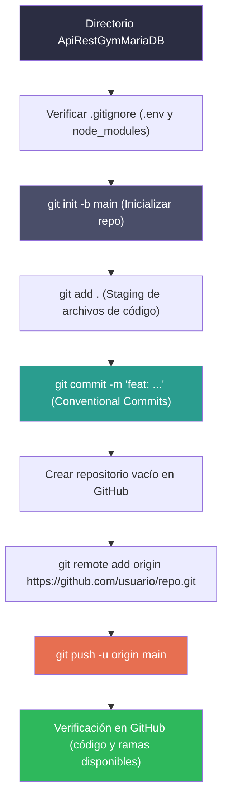

# Guía de Despliegue y Publicación del Repositorio en GitHub

Esta guía detalla el procedimiento técnico paso a paso para versionar, empaquetar y publicar el proyecto **ApiRestGymMariaDB** en un repositorio remoto de GitHub siguiendo el estándar **Conventional Commits v1.0.0**.

---

## 1. Objetivo y Prerrequisitos

### Objetivo
Inicializar el control de versiones local con Git, asegurar la exclusión de credenciales sensibles mediante `.gitignore`, realizar commits atómicos estructurados y vincular el repositorio local con un repositorio remoto en GitHub para subir el código con la rama principal `main`.

### Prerrequisitos del Sistema
- **Git instalado**: versión `2.40+` comprobable con `git --version`.
- **Cuenta activa en GitHub**: acceso a [github.com](https://github.com).
- **Credenciales Git configuradas**:
  - Usuario: `git config --global user.name "Tu Nombre"`
  - Email: `git config --global user.email "tu_correo@gmail.com"`
- **Directorio de trabajo**: `C:\Users\educr\Desktop\2DAM\ProgramacionServiciosProcesos\ApiRestGymMariaDB`.

---

## 2. Diagrama Visual del Procedimiento



---

## 3. Desglose Cronológico Paso a Paso

### Paso 1: Verificación de Higiene y Archivos Sensibles (`.gitignore`)
Antes de añadir archivos al índice de Git, es fundamental comprobar que las variables de entorno con contraseñas no se suban al repositorio público.

Comprobar que [.gitignore](file:///c:/Users/educr/Desktop/2DAM/ProgramacionServiciosProcesos/ApiRestGymMariaDB/.gitignore) contenga:
```gitignore
node_modules/
dist/
*.log
*.zip
.env
src/config/.env
```

Y verificar que exista una plantilla segura en [src/config/.env.example](file:///c:/Users/educr/Desktop/2DAM/ProgramacionServiciosProcesos/ApiRestGymMariaDB/src/config/.env.example):
```env
PORT=3024
API_KEY=EduApiKey

MARIADB_HOST=127.0.0.1
MARIADB_PORT=3308
MARIADB_USER=root
MARIADB_PASSWORD=root
MARIADB_DATABASE=mi_base
MARIADB_USERNAME=root
MARIADB_URI=http://localhost:3308
```

---

### Paso 2: Preparación del Stage y Commits Atómicos

Siguiendo el estándar **Conventional Commits v1.0.0** (sin emojis y en imperativo):

1. Añadir los archivos del proyecto al área de preparación:
   ```bash
   git add .
   ```

2. Comprobar que ningún archivo dentro de `node_modules` ni `src/config/.env` esté en la lista:
   ```bash
   git status
   ```

3. Realizar el commit inicial:
   ```bash
   git commit -m "feat(api): implement mariadb gym rest api with single controller and swagger"
   ```

---

### Paso 3: Crear el Repositorio en GitHub

1. Ingresar en [GitHub](https://github.com/new).
2. Configurar los campos del nuevo repositorio:
   - **Repository name**: `ApiRestGymMariaDB` (o el nombre preferido).
   - **Description**: `RESTful API modular en TypeScript con Express 5, MariaDB y Swagger OpenAPI`.
   - **Visibility**: `Public` o `Private`.
   - **Initialize this repository with**: **NO** marcar README, **NO** marcar .gitignore, **NO** marcar license (para evitar conflictos de ramas).
3. Hacer clic en **Create repository**.
4. Copiar la URL del repositorio remoto (ejemplo: `https://github.com/tu_usuario/ApiRestGymMariaDB.git`).

---

### Paso 4: Vincular el Remoto y Subir el Código

En la terminal, dentro de la carpeta del proyecto:

1. Asignar el origen remoto:
   ```bash
   git remote add origin https://github.com/TU_USUARIO/ApiRestGymMariaDB.git
   ```

2. Confirmar que la rama activa es `main`:
   ```bash
   git branch -M main
   ```

3. Subir el proyecto por primera vez estableciendo el upstream:
   ```bash
   git push -u origin main
   ```

> [!NOTE]
> Si GitHub solicita autenticación por terminal en Windows, se abrirá la ventana del navegador de Git Credential Manager para autorizar con un clic, o pedirá un Personal Access Token (PAT).

---

## 4. Verificación y Pruebas Empíricas

Para validar que el repositorio ha quedado perfectamente sincronizado:

1. **Inspección de remotos locales**:
   ```bash
   git remote -v
   ```
   *Salida esperada*:
   ```text
   origin  https://github.com/TU_USUARIO/ApiRestGymMariaDB.git (fetch)
   origin  https://github.com/TU_USUARIO/ApiRestGymMariaDB.git (push)
   ```

2. **Inspección del historial de commits**:
   ```bash
   git log --oneline -n 5
   ```

3. **Comprobación en la interfaz web de GitHub**:
   - Abrir `https://github.com/TU_USUARIO/ApiRestGymMariaDB`.
   - Verificar que se visualice la estructura de carpetas (`src/`, `data/`, `README.md`, etc.).
   - Confirmar que **NO** aparezca `src/config/.env` ni `node_modules/`.

---

## 5. Gestión de Errores y Casos Límite

> [!WARNING]
> **Conflicto `rejected - non-fast-forward` (fetch first)**: Si marcaste la casilla de crear README en la web de GitHub, el remoto tendrá un commit que tu copia local no tiene. Para resolverlo sin perder cambios:
> ```bash
> git pull origin main --rebase
> git push -u origin main
> ```

> [!CAUTION]
> **Credenciales filtradas**: Si en algún momento se comete un archivo `.env` por error, no basta con borrarlo en el siguiente commit (permanecería en el historial de Git). Si esto sucediera, hay que sacarlo del índice con `git rm --cached src/config/.env` y regenerar las contraseñas expuestas.
