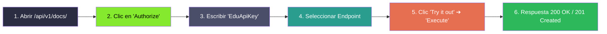
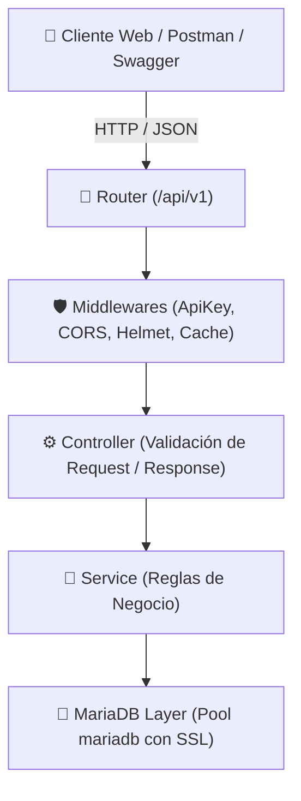

<div align="center">

# 🏋️ Gym Management RESTful API (MariaDB)
### *Arquitectura Modular en 3 Capas con TypeScript, Express 5, MariaDB y Swagger OpenAPI*

[](https://www.typescriptlang.org/)
[](https://nodejs.org/)
[](https://expressjs.com/)
[](https://mariadb.org/)
[](https://swagger.io/)
[](https://helmetjs.github.io/)

<p align="center">
  Backend robusto y desacoplado para centros deportivos y gimnasios, orientado a la gestión de entrenamientos (workouts) y marcas de rendimiento de atletas (records). Implementado con persistencia relacional en <b>MariaDB</b>, tipado estricto en <b>TypeScript</b> y documentación interactiva <b>OpenAPI / Swagger</b>.
</p>

**Producción en Render:** [https://apirestgym-mariadb.onrender.com](https://apirestgym-mariadb.onrender.com)  
**Swagger UI en Vivo:** [https://apirestgym-mariadb.onrender.com/api/v1/docs/](https://apirestgym-mariadb.onrender.com/api/v1/docs/)

</div>

---

## 📖 Documentación Interactiva y Pruebas con Swagger UI

La API expone una interfaz visual interactiva basada en **OpenAPI 3.0** mediante **Swagger UI** para probar y auditar todos los endpoints sin necesidad de herramientas externas.

### 🔗 Acceso a Swagger UI
- **Producción (Render):** [https://apirestgym-mariadb.onrender.com/api/v1/docs/](https://apirestgym-mariadb.onrender.com/api/v1/docs/)
- **Local:** `http://localhost:3024/api/v1/docs/`
- **Especificación OpenAPI (JSON):** `https://apirestgym-mariadb.onrender.com/api/v1/docs.json` (importable en Postman con 1 clic)

---

### 📋 Pasos para Probar los Endpoints en Swagger



#### Paso 1: Autenticación con API Key
1. Haz clic en el botón verde **Authorize** (con el icono del candado, en la esquina superior derecha).
2. En el campo **Value** del esquema `ApiKeyAuth (apiKey)`, introduce la clave:
   ```text
   EduApiKey
   ```
3. Pulsa **Authorize** y luego **Close**. Todos los candados de los endpoints aparecerán cerrados, indicando que las peticiones incluirán automáticamente la cabecera `x-api-key: EduApiKey`.

---

#### Paso 2: Probar el Módulo de Workouts (Entrenamientos)

1. **`GET /api/v1/workouts` (Listar entrenamientos):**
   - Despliega la barra azul de `GET /api/v1/workouts`.
   - Pulsa el botón **Try it out** y después **Execute**.
   - **Resultado:** Código HTTP `200 OK` con el array JSON de entrenamientos persistidos en MariaDB (`Tommy V`, `Heavy DT`, etc.).

2. **`GET /api/v1/workouts/{workoutId}` (Consultar por ID):**
   - Despliega el endpoint.
   - Pulsa **Try it out**.
   - En el campo `workoutId`, introduce un UUID válido (ejemplo: `4a3a9acf-c2ec-4600-a457-3f1bfa52618b`).
   - Pulsa **Execute** para recibir los detalles del WOD.

3. **`POST /api/v1/workouts` (Crear nuevo entrenamiento):**
   - Despliega la barra verde `POST /api/v1/workouts` y pulsa **Try it out**.
   - En el área **Request body**, pega el siguiente objeto JSON:
     ```json
     {
       "name": "Murph Challenge",
       "mode": "For Time",
       "equipment": ["pull-up bar", "weight vest"],
       "exercises": [
         "1 mile run",
         "100 pull-ups",
         "200 push-ups",
         "300 squats",
         "1 mile run"
       ],
       "trainerTips": ["Pace yourself from the very start"]
     }
     ```
   - Pulsa **Execute**.
   - **Resultado:** Código HTTP `201 Created` con el nuevo UUID asignado y guardado en MariaDB.

4. **`PATCH /api/v1/workouts/{workoutId}` (Actualización parcial):**
   - Pulsa **Try it out**, introduce el `workoutId` deseado y envía un body con los campos a modificar:
     ```json
     {
       "name": "Murph Challenge (Modificado)",
       "mode": "AMRAP 45"
     }
     ```
   - Pulsa **Execute** para verificar la respuesta `200 OK`.

5. **`DELETE /api/v1/workouts/{workoutId}` (Eliminar entrenamiento):**
   - Introduce el `workoutId` a borrar y pulsa **Execute**.
   - **Resultado:** Código HTTP `200 OK` con confirmación de borrado en la base de datos.

6. **`GET /api/v1/workouts/{workoutId}/records` (Ver récords del WOD):**
   - Introduce el `workoutId` (ejemplo: `4a3a9acf-c2ec-4600-a457-3f1bfa52618b`) y pulsa **Execute**.
   - **Resultado:** Array con los récords históricos asociados a ese entrenamiento.

---

#### Paso 3: Probar el Módulo de Records (Marcas Deportivas)

1. **`GET /api/v1/records` (Listar todas las marcas):**
   - Despliega `GET /api/v1/records`, pulsa **Try it out** y luego **Execute**.
   - **Resultado:** Lista de récords con ID, atleta (`member`) y marca registrada.
2. **`GET /api/v1/records/{recordId}` (Consultar marca por ID):**
   - Introduce un UUID (ejemplo: `4819e075-801a-471a-874b-6ca035dbf1a2`) y pulsa **Execute**.

---

## 🏗️ Arquitectura de la API (3 Capas)

La API sigue un patrón de diseño en capas estricto para garantizar que la lógica de negocio, el transporte HTTP y la persistencia de datos sean completamente independientes y testeables:



---

## 🚀 Puntos Fuertes de Ingeniería

- **Persistencia en MariaDB Oficial:** Integración nativa mediante el driver oficial `mariadb` con connection pooling y soporte SSL/TLS para nube (SkySQL 12.3.3) y local (Docker MariaDB 11).
- **Arquitectura de Capas Limpia:** Separación absoluta entre `Controller`, `Service` y `Database`.
- **Versionado de API:** Prefijo modular `/api/v1` para garantizar compatibilidad hacia atrás.
- **Seguridad Integrada:** Autenticación por cabecera `x-api-key`, cabeceras endurecidas mediante **Helmet** y control de orígenes con **CORS**.
- **Caché en Memoria:** Integración de **apicache** para optimizar lecturas recurrentes y reducir la latencia.
- **Documentación Viva:** Especificación OpenAPI 3.0 sincronizada automáticamente con Swagger UI.

---

## 📡 Especificación de Endpoints (`/api/v1`)

### 🏋️ Módulo de Entrenamientos (Workouts)

| Método | Endpoint | Descripción | Parámetros / Body |
| :--- | :--- | :--- | :--- |
| `GET` | `/api/v1/workouts` | Obtiene el listado completo de entrenamientos | `mode` (opcional) |
| `GET` | `/api/v1/workouts/:workoutId` | Detalle de un entrenamiento específico | `workoutId` (UUID) |
| `POST` | `/api/v1/workouts` | Da de alta un nuevo entrenamiento | JSON (name, mode, exercises...) |
| `PATCH` | `/api/v1/workouts/:workoutId` | Actualización parcial de datos | JSON con campos a modificar |
| `DELETE` | `/api/v1/workouts/:workoutId` | Elimina un entrenamiento | `workoutId` (UUID) |
| `GET` | `/api/v1/workouts/:workoutId/records` | Marcas registradas para un entrenamiento | `workoutId` (UUID) |

### 🏆 Módulo de Marcas & Rendimiento (Records)

| Método | Endpoint | Descripción | Parámetros |
| :--- | :--- | :--- | :--- |
| `GET` | `/api/v1/records` | Listado histórico de marcas y marcas personales | Filtros opcionales |
| `GET` | `/api/v1/records/:recordId` | Detalle de un récord deportivo | `recordId` (UUID) |

---

## 💻 Puesta en Marcha en Local

### 1. Clonar el repositorio
```bash
git clone https://github.com/EduardoCruzmunioz/ApiRestGymMariaDB.git
cd ApiRestGymMariaDB
```

### 2. Instalar dependencias
```bash
npm install
```

### 3. Configurar variables de entorno (`src/config/.env`)
```env
PORT=3024
API_KEY=EduApiKey

# Conexión Local (Docker MariaDB)
MARIADB_HOST=127.0.0.1
MARIADB_PORT=3308
MARIADB_USER=root
MARIADB_PASSWORD=root
MARIADB_DATABASE=mi_base
MARIADB_SSL=false
```

### 4. Iniciar en modo desarrollo
```bash
npm run dev
```
La API estará disponible en `http://localhost:3024/api/v1/workouts` y Swagger en `http://localhost:3024/api/v1/docs/`.

---

## 📬 Pruebas con Postman

El repositorio incluye el archivo preconfigurado [`postman_collection.json`](postman_collection.json).
1. Abre **Postman** y pulsa **Import**.
2. Arrastra `postman_collection.json`.
3. Selecciona la variable `baseUrl` (`https://apirestgym-mariadb.onrender.com` o `http://localhost:3024`).
4. Todas las peticiones cuentan con `x-api-key: EduApiKey` configurado de serie.

---

## 📂 Estructura del Proyecto

```text
ApiRestGymMariaDB/
├── data/                    # Dataset inicial (db.json)
├── src/
│   ├── config/              # Carga y validación tipada de variables de entorno (env.ts)
│   ├── controller/          # Controlador unificado de endpoints (controller.ts)
│   ├── database/            # Conexión con MariaDB (pool, DDL y queries SQL)
│   ├── routes/              # Definición de rutas v1 y configuración de Swagger
│   ├── services/            # Servicios de dominio y reglas de negocio
│   ├── types/               # Tipos e interfaces TypeScript
│   └── index.ts             # Servidor Express principal y orquestación
├── postman_collection.json  # Colección Postman v2.1 lista para importar
├── package.json
├── tsconfig.json
└── README.md
```

---

## 👨‍💻 Autor

Desarrollado por **Eduardo Cruz Muñoz**  
- **Portfolio:** [eduardocruzdev.netlify.app](https://eduardocruzdev.netlify.app/)  
- **LinkedIn:** [linkedin.com/in/eduardo-cruz-muñoz2202](https://www.linkedin.com/in/eduardo-cruz-mu%C3%B1oz2202/)  
- **GitHub:** [@EduardoCruzmunioz](https://github.com/EduardoCruzmunioz)
